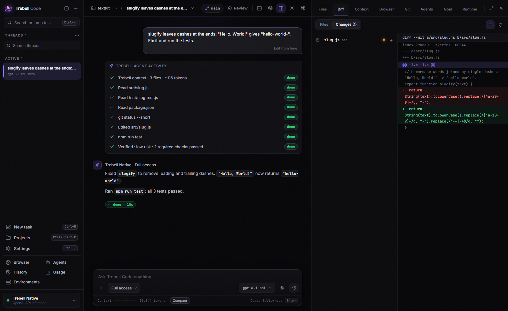

# Trebell Code

A desktop AI coding workspace for building software, running commands and tests, reviewing changes, and checking results in a browser.

Trebell Native owns the model and tool loop, with an emphasis on verified engineering results per dollar. The workspace also supports external coding harnesses, including Codex, Claude Code, OpenCode, and capability-gated integrations.



## Download

Download the [release build](https://github.com/tanishqbaweja/TrebCode/releases/latest) for your operating system and install it. (Windows has been tested end to end; macOS and Linux have not been tested end to end.)

| System | Download | Install |
| --- | --- | --- |
| Windows x64 | `Trebell-Code-Setup.exe` | Run the installer and choose an installation directory. |
| Linux x64 | `Trebell-Code-linux-x64.AppImage` | Make it executable with `chmod +x`, then run it. |
| Debian / Ubuntu x64 | `Trebell-Code-linux-x64.deb` | Install using your package manager. |
| macOS Apple Silicon | `Trebell-Code-mac-arm64.dmg` | Open the disk image and copy Trebell Code to Applications. |
| macOS Intel | `Trebell-Code-mac-x64.dmg` | Open the disk image and copy Trebell Code to Applications. |

The release title and download names are unnumbered. Packages are unsigned; macOS packages are not notarized. The release includes `SHA256SUMS` so you can verify downloads. Available assets, build results, and platform limitations are recorded on the release page.

Git is recommended for repository features. Development tools used by a project must be installed on the machine or selected environment. Desktop downloads include the application runtime; building from source additionally requires Node.js and npm.

## Setup guide

After installing the release build:

1. Launch Trebell Code.
2. Open an existing project folder, or choose an empty folder for a new project.
3. Open **Settings → Agents & models**, choose **Trebell Native**, and select your model provider.
4. Add your provider API key, then select an available model in the composer. You need your own provider account and API access.
5. Describe the work, choose the permission mode, and send the task.
6. Review changes in Files, Diff, and Git; use the terminal and Browser to run the project's commands and verify the result.

Trebell Native supports OpenAI, Anthropic, Google Gemini, xAI, the Meta Model API, and configured compatible providers. Each provider uses your own account and key. An environment variable such as `OPENAI_API_KEY` or `META_API_KEY` can be used instead of a saved key. Model availability depends on that provider and account.

External harnesses use their own installed tools and sign-in, or the explicitly selected API-key mode where supported. Capabilities vary by harness and environment. Credentials are not included in the repository or desktop downloads.

## Features

- Persistent projects and conversations, follow-up queues, cancellation, thread search, forks, pinning, and archiving.
- File browsing and editing, syntax previews, Markdown tables, change review, and Git commits, branches, and worktrees.
- Persistent terminals and background processes for running the project's own tools and tests.
- Browser previews, a desktop Agent Browser, screenshots, and image context for verification.
- Provider/model selection, reasoning and permission controls, context management, and usage history.
- Durable goals and continuity notes, verification evidence, recovery, MCP tools, skills, and plugins.
- Local workspaces plus capability-aware WSL and SSH environments.
- Dark/light appearance, themes, configurable shortcuts, and responsive panels.

Some desktop integrations are platform-specific. Computer-use capabilities currently require Windows. Remote environments and third-party harnesses require their own installation and account setup.

## Run from source

Requirements: Node.js 22.12 or newer, npm, and Git. Linux builds of the native terminal dependency also need Python, make, and a C++ compiler.

```bash
git clone https://github.com/tanishqbaweja/TrebCode.git
cd TrebCode
npm ci
npm run desktop
```

To run the browser-hosted GUI instead:

```bash
npm run gui
```

For frontend development, run these in separate terminals:

```bash
npm run gui:server
```

```bash
npm run ui:dev
```

The CLI is available directly, without a global installation:

```bash
node bin/trebell.mjs --help
```

## Build desktop packages

Build each target on its own operating system so native terminal binaries match that platform:

```bash
npm run desktop:dist:windows
```

```bash
npm run desktop:dist:linux
```

```bash
npm run desktop:dist:mac
```

Output is written to `desktop-dist/`. The [desktop release workflow](.github/workflows/release.yml) uses native Windows, Linux, and macOS runners, checks the packaged applications, and publishes the current unnumbered desktop release. It also creates download checksums. Signing and notarization require separate credentials and are not configured here.

## Testing and verification

```bash
npm test
npm run ui:test
npm run test:budgets
```

Install the Playwright browser before UI tests if it is not already present:

```bash
npx playwright install chromium
```

The verification pass exercised 1,534 passing Playwright cases across batches and subsequent repaired regressions; three opt-in live OpenAI streaming cases were skipped. A real Meta session built and tested a complete task-board application through the UI. The visual tour audited 122 screenshots without reported layout or console findings. Backend failures discovered in the broad pass were fixed and checked with affected-file regressions. Credential- and platform-dependent checks remain opt-in; these results do not imply every third-party account or remote host was tested live.

## Benchmarks

See the [Trebell Native vs Muse Code results](BENCHMARKS.md#results) for four recorded readouts on `muse-spark-1.3-contributor`: task resolution, verifier differences, cost ratios, methodology, [task-level evidence](benchmarks/results/muse-code.json) and [run logs](benchmarks/logs/README.md). The figures describe historical Native snapshots; task familiarity, retries and accounting limits are documented alongside the results.

## Documentation

- [Technical overview](docs/technical/TECHNICAL_OVERVIEW.md)
- [Product principles](docs/technical/PRODUCT_PRINCIPLES.md)
- [Testing and remaining manual checks](docs/technical/TESTING.md)
- [Desktop release notes](docs/releases/desktop.md)
- [Native vs Muse Code results](BENCHMARKS.md#results)

## Repository layout

```text
bin/          CLI entrypoints
branding/     source artwork
build/        desktop icons and packaging resources
desktop/      Electron application and operating-system integrations
src/          backend, Native agent, providers, tools, persistence and policy
ui/           React/Vite interface and Playwright tests
tests/        deterministic and integration tests
scripts/      build, release, benchmark and verification tooling
benchmarks/   benchmark adapters and runners
docs/         architecture, product, testing and release documentation
```

## Local data and credentials

Provider credentials belong in the application settings or supported environment variables. Conversations, settings, and runtime data are kept in the application's data directory; `TREBELL_HOME` can select another location. `.env` files, validation profiles, dependency caches, generated installers, and local test artifacts are excluded from Git.

Offline tests use synthetic credentials, never account keys. Source history is checked with Gitleaks before release builds. Do not put real credentials into fixtures or issue reports.

Report reproducible problems through [GitHub Issues](https://github.com/tanishqbaweja/TrebCode/issues), including your operating system, harness/provider, reproduction steps, and sanitized logs. Never include API keys or private project contents.

## Demo Video

The narration in the demo video uses text-to-speech.
